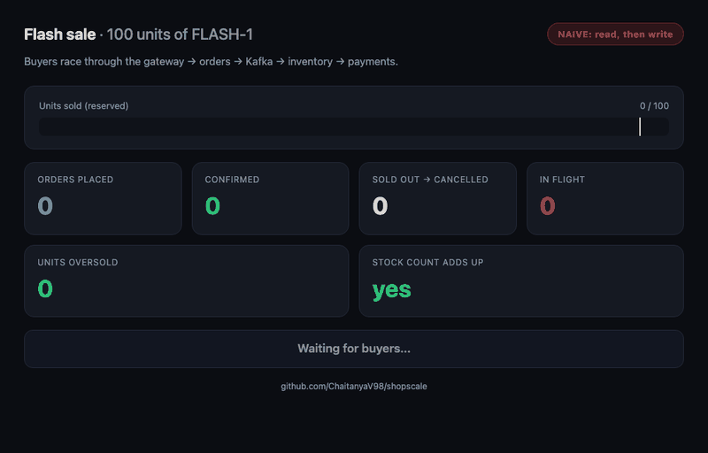

# ShopScale

[](https://github.com/ChaitanyaV98/shopscale/actions/workflows/ci.yml)

**An e-commerce backend built for flash-sale traffic: orders, inventory and payments as independent
services that stay consistent when thousands of buyers race for a hundred units.**

**Live demo: [shopscale.onrender.com/dashboard](https://shopscale.onrender.com/dashboard)**. Press
*Run a flash sale*: 600 simulated buyers race for 50 units through the real services (one sale every
5 minutes for the whole site). It's on a free tier, so the first visit after a quiet spell takes about
a minute to wake up.



*The same 2,000-buyer flash sale twice, on the live dashboard (`localhost:4000/dashboard`): first with a
naive read-then-write, then with row locks.*

## Results

k6, 2,000 buyers racing for 100 units through the gateway, while 5 bots hammer it (one 8 GB laptop
running every service, Postgres, Redpanda and Redis):

| | Naive stock update (read, then write) | **ShopScale (`SELECT … FOR UPDATE`)** |
|---|---|---|
| Orders confirmed for 100 units | 307–440 (varies per run) | **100** |
| Units oversold | 207–340 | **0** (every run) |
| Stock count consistent afterwards | no | **yes** |
| Buyer orders accepted | 2,000 / 2,000 | **2,000 / 2,000** |
| Bot requests rate-limited (429) | | **~70%** (699 of 994) |
| Order placement latency, p95 | | **500–660 ms** (200 concurrent clients) |
| Placed → confirmed/cancelled, p95 | 2.9 s | **3.3–4.3 s** (the whole rush settles in < 4.5 s) |

Same test on Kubernetes (`kind`) with **two replicas of every service**: 300 buyers for 20 units,
exactly 20 confirmed, the two inventory pods splitting the Kafka partitions 3/3.

The lock costs some speed: every reservation for one hot item waits its turn on one row
([ADR 4](docs/adr/0004-row-locking-against-overselling.md) covers that trade-off and how to reduce it).

## How it works

```
                 ┌──────────┐   429 if over limit (Redis token bucket)
  client ──────► │ gateway  │──────────────────────────────────────────┐
                 └────┬─────┘                                          │
           POST /orders│ (Idempotency-Key)                    GET /orders/:id, /products/:sku
                       ▼
  ┌────────────────────────────────┐        ┌──────────────────────────────────┐        ┌───────────────────────────┐
  │ orders          (own database) │        │ inventory         (own database) │        │ payments   (own database) │
  │ order PENDING + outbox event   │        │ lock rows, reserve or reject      │        │ charge with idempotency   │
  │ status: forward-only machine   │        │ release on payment failure        │        │ key = order id            │
  └───────┬─────────────▲──────────┘        └──────┬──────────────▲─────────────┘        └─────┬────────────▲────────┘
          │ OrderPlaced │ StockReserved/Rejected,   │ StockReserved│ OrderPlaced,              │ Payment    │ Stock
          ▼             │ PaymentCaptured/Failed    ▼ /Rejected    │ PaymentFailed             ▼ Captured/  │ Reserved
  ════════════════════════════════════════  Kafka (Redpanda), keyed by order id  ════════════════════════════════════════
```

1. **The gateway** rate-limits each customer (token bucket in Redis, atomic Lua script) and routes to
   the service that owns the data. It's the only public port.
2. **Orders** stores the order as `PENDING` and an `OrderPlaced` event **in the same transaction**
   (transactional outbox), then answers `202 Accepted`. An `Idempotency-Key` makes retries safe.
3. **Inventory** locks the product rows (`SELECT … FOR UPDATE`, in SKU order so multi-item orders can't
   deadlock) and reserves stock or rejects the order.
4. **Payments** charges, using the order id as the provider's idempotency key, so a crash and retry
   never charges twice.
5. If payment fails, inventory **releases** the stock (saga compensation) and the order is cancelled.

Every event can arrive twice (at-least-once delivery), so every consumer records event ids in an
**inbox** table in the same transaction as its effects: exactly-once effects, at-least-once delivery.
Events from different topics can arrive out of order, so order status only ever moves **forward**.

## Design decisions

| ADR | Decision |
|---|---|
| [1](docs/adr/0001-database-per-service.md) | Each service owns its database; they only talk through events |
| [2](docs/adr/0002-transactional-outbox-and-inbox.md) | Transactional outbox to publish, idempotent inbox to consume |
| [3](docs/adr/0003-choreographed-saga.md) | Choreographed saga with compensation, no central orchestrator |
| [4](docs/adr/0004-row-locking-against-overselling.md) | Pessimistic row locks against overselling (with measurements) |
| [5](docs/adr/0005-idempotency-keys.md) | Idempotency keys for order placement and payments |
| [6](docs/adr/0006-token-bucket-rate-limiting.md) | Redis token bucket, failing open if Redis is down |
| [7](docs/adr/0007-redpanda-and-kafka-client.md) | Redpanda locally, Confluent's Kafka client, order id as message key |
| [8](docs/adr/0008-forward-only-order-state.md) | Forward-only order state machine for out-of-order events |

## Tech stack

Node.js 24 · TypeScript · Fastify · PostgreSQL 17 · Kafka (Redpanda) · Redis · Zod · Vitest · k6 ·
Docker · Kubernetes (kind) · GitHub Actions

No build step: Node 24 runs the TypeScript directly (type stripping), so the image only contains
the sources and production dependencies.

## Run it

You need Node 24 and Docker.

```bash
npm install
npm run infra:up          # Postgres :5436, Redpanda :19092, Redis :6381
npm run migrate && npm run seed
npm run dev               # gateway :4000 + orders, inventory, payments

curl -X POST localhost:4000/orders -H 'content-type: application/json' \
  -H "Idempotency-Key: $(uuidgen)" -H 'X-Customer-Id: alice' \
  -d '{"customerId":"alice","items":[{"sku":"MUG","quantity":2}]}'
curl localhost:4000/orders/<orderId>      # PENDING → RESERVED → CONFIRMED
```

Customers whose id starts with `declined` always have their card declined, to see compensation.

**Everything in Docker:** `docker compose --profile app up --build` (gateway on :4000).

| Command | What it does |
|---|---|
| `npm test` | Unit tests: state machine, idempotency hashing, event contracts |
| `npm run test:int` | Concurrency and consistency tests against real Postgres and Redis |
| `npm run loadtest` | k6 flash sale (Docker image) + report: oversold, stock consistency, latency |
| `RESERVATION_MODE=naive npm run dev` then `MODE=naive npm run loadtest` | The same test without the row lock, to watch it oversell |
| `bash scripts/smoke.sh` | End-to-end: order confirmed, declined payment compensated |
| `localhost:4000/dashboard` | Live flash-sale dashboard (watch it during `npm run loadtest`) |

### Kubernetes

```bash
docker build -t shopscale:dev .
kind create cluster --name shopscale
kind load docker-image shopscale:dev --name shopscale
kubectl apply -k deploy/k8s
kubectl -n shopscale port-forward svc/gateway 4000:4000
```

Two replicas of each service, health probes, resource limits and graceful shutdown. Postgres,
Redpanda and Redis run in-cluster as single-replica dev stand-ins for managed services.

## What the tests prove

- 50 concurrent buyers for 10 units → exactly 10 reserved; multi-SKU orders locking in opposite orders don't deadlock
- A redelivered event has no second effect; compensation applied twice releases stock once
- A crash between charging and committing charges the customer once
- 10 racing retries with one `Idempotency-Key` → one order
- Out-of-order events still end in the right state
- 100 concurrent requests on a 10-token bucket → exactly 10 admitted
- CI also builds the image, starts the full stack with Kafka, and runs the end-to-end smoke test

## Deployment (free tiers)

| Piece | Where |
|---|---|
| All four services, one container (`SERVICE=all`) | Render free web service, Singapore ([`render.yaml`](render.yaml)) |
| Postgres, one database per service | Neon, Singapore |
| Kafka | Aiven free tier (TLS client certificates, 2 partitions per topic) |
| Redis | Render Key Value (free) |

On the live site, a 600-buyer sale for 50 units settles in about 45 seconds with 0 oversold.

Deploying found three problems that the laptop setup hid:

- **Connection-pool deadlock.** Payments held a database transaction open while calling the payment
  provider, which needed a second connection from the same pool. With a pool of 20 locally nobody
  noticed; with the free tier's pool of 4 and 6 concurrent handlers, the consumer froze. The provider
  call now happens before the transaction opens (regression test: 12 charges on 2 connections).
- **Restocking deleted live reservations.** A restock during an in-flight sale removed reservations
  that compensation still needed. Restocks no longer delete anything.
- **Neon roles could read each other's databases.** Roles created through Neon's API get broad
  privileges, so the app now connects as SQL-created roles that can only read and write rows in their
  own database (no cross-database access, no DDL); migrations run separately as the owner.

## Project layout

```
src/lib/           outbox, inbox, Kafka, events, service runner
src/services/      gateway, orders, inventory, payments (logic.ts = business rules, main.ts = wiring)
migrations/        SQL per service database
loadtest/          k6 flash-sale script
deploy/k8s/        Kubernetes manifests (Kustomize)
docs/adr/          architecture decision records
```

## License

MIT
